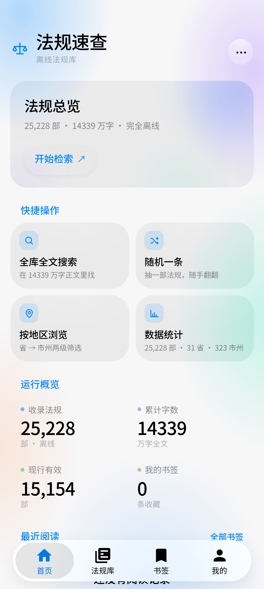
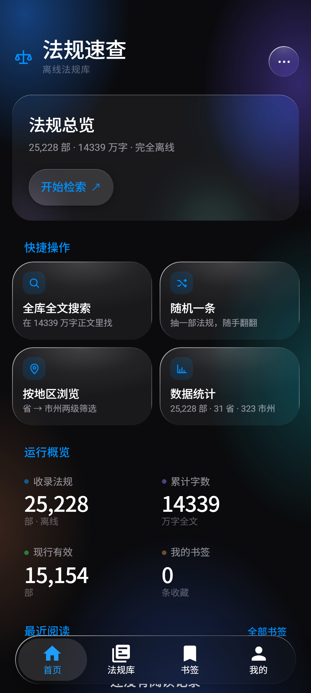
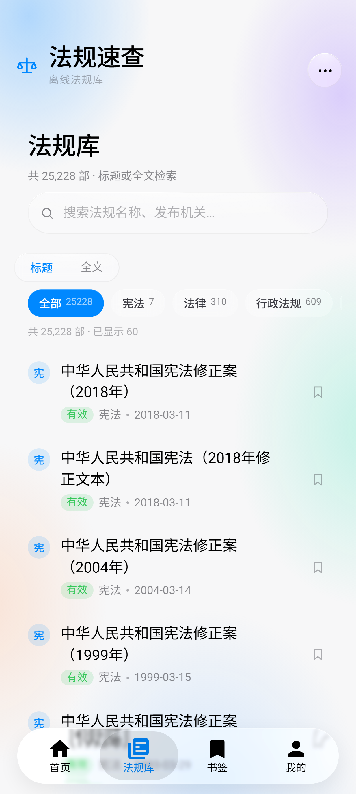
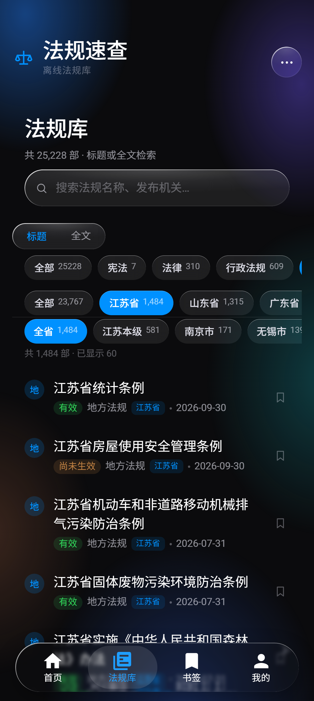
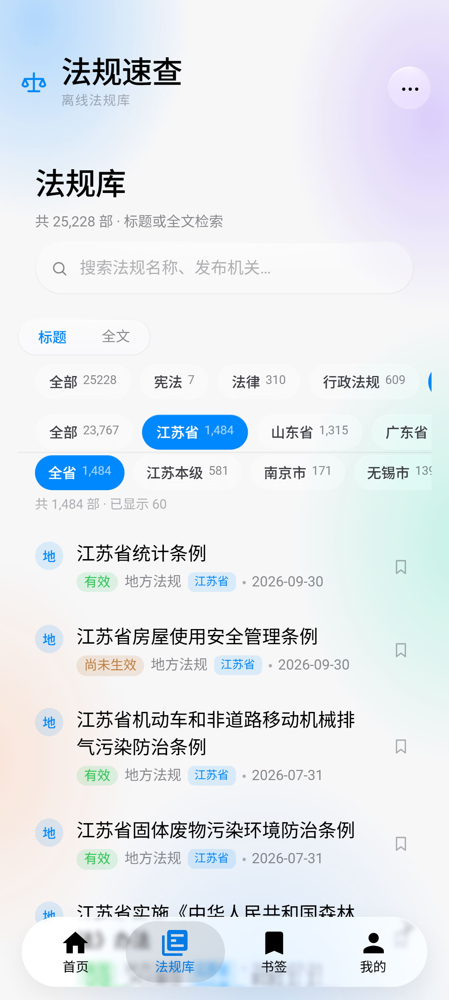
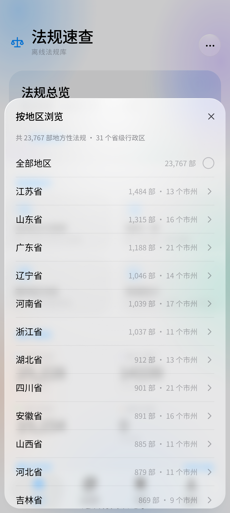
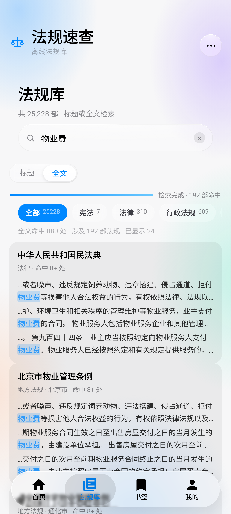
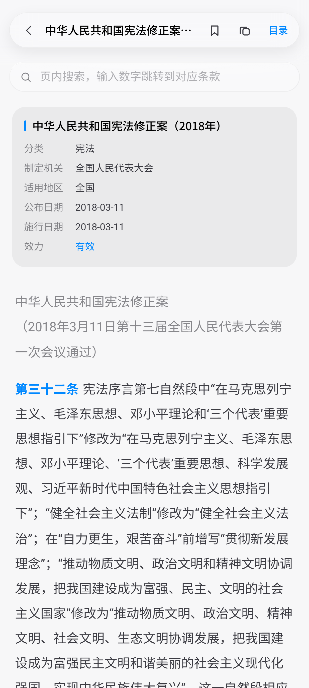

<div align="center">

# LexiGlass

**一款完全离线的法律法规速查应用，采用液态玻璃（Liquid Glass）设计语言。**

内置 **2.5 万部** 法规全文、**1.4 亿字**，支持标题 / 全文关键词检索与按地区两级浏览，全程不联网。

</div>

## 截图

| 浅色 | 深色 |
|:---:|:---:|
|  |  |
|  |  |
|  |  |
|  |  |

## 特性

- **全量离线**：25,228 部法规（宪法、法律、行政法规、司法解释、23,767 部地方性法规），1.43 亿字正文随包携带，断网可用。
- **全文检索**：1.43 亿字全库关键词扫描约 3 秒，命中词高亮、可直接跳转到对应条文。
- **按地区两级浏览**：一级省级行政区，二级「省本级 + 下辖市州」，县级法规自动归到所属地级市。
- **液态玻璃 UI**：毛玻璃折射、透镜高光、弹簧动效、悬浮 Dock，浅色 / 深色 / 跟随系统三态。
- **沉浸模式**：隐藏状态栏，内容铺满整屏。
- **零权限**：不申请任何敏感权限，不联网、不上传。

## 数据说明

法规文本来自公开的**国家法律法规数据库**（flk.npc.gov.cn）。本项目不内置数据文件，而是提供采集脚本：

```bash
python tools/crawl_local.py catalog   # 抓目录（约 24,000 条）
python tools/crawl_local.py docs      # 下载正文并解析
python tools/crawl_local.py pack      # 生成分片数据 → app/assets/web/data/
```

> 依赖：`pip install requests olefile`。采集脚本支持断点续传、`docx` 与旧版 `doc`（OLE 二进制）两种格式，并按全国区划表（`tools/region_map.json`，已内置）把每条法规归到省 / 市州。法规文本版权归原发布机关所有。

## 架构

```
app/
├── AndroidManifest.xml                  # 单 Activity，纯 WebView 壳
├── res/                                 # 图标 + 主题（adaptive icon）
├── assets/web/                          # H5 前端（运行时经 file:///android_asset/web/ 加载）
│   ├── index.html
│   ├── css/     app.css · glass-skin.css
│   ├── js/      app.js（列表 / 检索 / 阅读 / 收藏 / 设置）
│   ├── lg/      liquid-glass.js · theme-boot.js（玻璃引擎 + 主题）
│   └── vendor/  dock.js · dock.css（悬浮 Dock）
└── src/main/java/com/lexi/reader/MainActivity.java
tools/                                    # 构建 + 数据采集
```

- 原生层只有 ~400 行：WebView 初始化、edge-to-edge / 沉浸模式、安全区 insets 推送、`getSystemTheme` / `setImmersive` 等 JS 桥。
- 全部 UI 与业务逻辑在 H5 层，便于独立开发与预览。
- 法规数据用「分片 pack + 紧凑数组」存储：列表只读 `index.json`，点开才加载所在分片，片级 LRU 最多驻留 3 片；全文检索并发 3 片流式扫描，内存峰值约 90 MB。

## 构建

### 方式一：Android Studio / Gradle

用 Android Studio 打开项目根目录，或命令行：

```bash
./gradlew assembleDebug
```

### 方式二：免 Gradle 脚本（Windows）

只要装了 Android SDK build-tools 与 JDK 11+：

```bash
bash tools/build.sh
```

产物在 `out/LexiGlass-1.0.0.apk`。脚本内部走 `aapt2 → javac → d8 → zipalign → apksigner` 全链路，不依赖 Gradle。

## License

[MIT](LICENSE) © 2026 Zihium

数据来源：国家法律法规数据库，版权归原发布机关所有。
